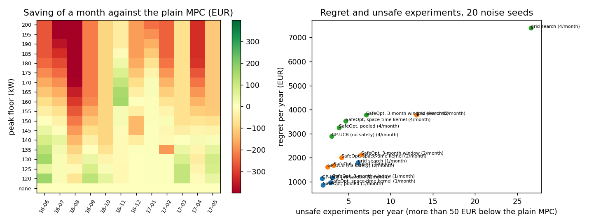
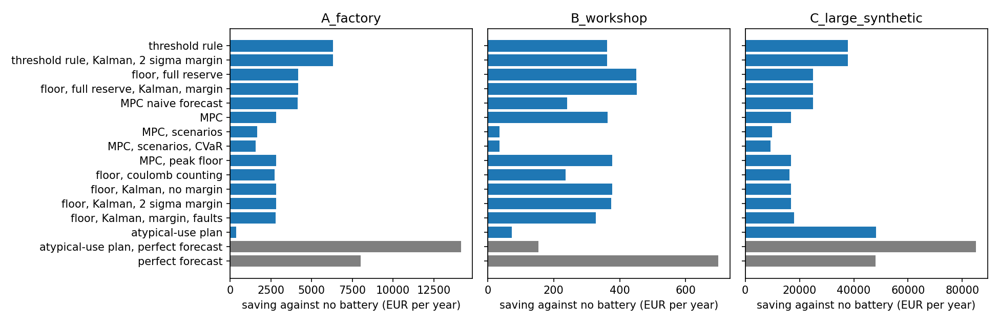
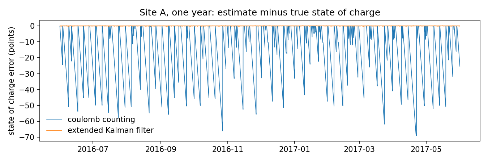

# de-site-energy-management

What is a load forecast worth to the energy management of an industrial site? A study on one year of metered
data from a small factory in Konstanz, Germany: day-ahead forecasts of load, cooling demand and PV; model
predictive control (MPC) of a battery, the cooling plant used as thermal storage and on-site PV, under day-ahead
prices and a German-style demand charge on the peak import.

Research study on public data. The site's load, cooling and PV profiles are metered; the battery, the PV size and
the tariff are assumptions stated below. Version 0.3 extends the study to a [fleet of sites](#v03-a-fleet-of-batteries-tariff-rules-on-site-control-and-lost-value) with German network-charge rules, an on-site controller with fallbacks, state of charge estimation and an account of the value lost between a perfect plan and the bill.

## Setup

- **Site.** `industrial3` of the Open Power System Data household data (CoSSMic project, Konstanz): grid import,
  PV and 17 sub-meters, hourly, February 2016 to June 2017. Mean load 82 kW, maximum 236 kW, lower on weekends;
  the chiller (cooling aggregate) draws up to 37 kW, mostly in summer.
- **Assets.** PV scaled from the metered roof and facade profile to 150 kWp (177 MWh in the test year, 1,180 kWh
  per kWp); battery 200 kWh / 100 kW, 90% round trip, 10% minimum charge; cold store of 40 kWh electric equivalent
  that lets the chiller run up to 40 kW ahead of the cooling demand (the same model describes a heat pump with a
  buffer tank).
- **Tariff.** Import at the day-ahead price (DE-AT-LU) plus 15 ct/kWh for grid fees, levies and taxes; export at
  the day-ahead price, PV curtailed at negative prices; demand charge 100 EUR per kW of the annual peak import
  (the German Leistungspreis for metered customers), with monthly peaks at 100/12 EUR per kW as a sensitivity;
  battery wear 3 ct per kWh discharged.
- **Test year.** 1 June 2016 to 31 May 2017 (8,760 hours). Everything before is training data only.

## Forecasts

Issued at noon of the day before, with measurements up to then (lags of at least 48 hours), refitted every month on
all earlier data (`src/siteems/forecast.py`):

| Forecast | Load MAE (kW) | Load RMSE | Daily peak MAE | Cooling MAE | PV MAE |
|---|---|---|---|---|---|
| Naive (same hour one week earlier; PV: mean of 7 days) | 16.2 | 26.7 | 28.1 | 4.6 | 9.0 |
| Gradient boosting, calendar and lags | 15.0 | 22.0 | 25.3 | 6.5 | 10.4 |
| Gradient boosting with weather (ERA5) | 13.3 | 20.8 | 25.9 | 3.2 | 6.5 |

Weather lowers the load error by 18% against the naive forecast and halves the PV and cooling errors without
weather. ERA5 is a reanalysis standing in for a numerical weather forecast, so the weather variant is optimistic.
A 90% quantile model is fitted alongside for the robust peak variant.

## Energy management

Every hour a linear program (SciPy, HiGHS) plans battery charge and discharge, chiller power, curtailment, import
and export to the end of the day, or to the end of the next day once its prices are known at 13:00, minimising
energy cost minus export revenue plus the demand charge on any rise of the peak plus battery wear. Only the first
hour is carried out with the real load; a local controller discharges further if the real import would pass the
planned peak, and the forecasts are corrected with the last observed error (`src/siteems/ems.py`).

## Results (annual demand charge, EUR per year)

The site without battery or flexibility pays 124,909 EUR (energy 105,173, demand charge 20,021 on a 200 kW peak).

| Strategy | Saving | Energy and export | Demand charge | Peak (kW) | Cycles |
|---|---|---|---|---|---|
| Rule: PV self-consumption | 1,184 | 1,471 | 0 | 200 | 48 |
| Rule: peak threshold at 167 kW | 3,326 | -29 | 3,365 | 167 | 2 |
| MPC, naive forecast | 3,220 | 1,016 | 2,522 | 175 | 53 |
| MPC, ML forecast | 2,505 | 928 | 1,878 | 181 | 50 |
| MPC, ML forecast with weather | 2,644 | 1,114 | 1,878 | 181 | 58 |
| MPC, ML with weather, P90 load in the peak constraint | 3,268 | 1,111 | 2,550 | 175 | 66 |
| MPC, naive forecast, peak floor at 167 kW | 3,716 | 1,023 | 3,013 | 170 | 53 |
| **MPC, ML with weather, peak floor at 167 kW** | **3,784** | 1,118 | 3,013 | 170 | 58 |
| MPC, perfect forecast (upper bound) | 7,150 | 1,966 | 5,660 | 144 | 79 |
| MPC, battery only (ML with weather) | 2,528 | 1,049 | 1,859 | 182 | 63 |
| MPC, cooling flexibility only (ML with weather) | 155 | 137 | 19 | 200 | |

Battery wear is included in the saving and not shown in the two middle columns. The threshold, 167 kW, is the 99.9th
percentile of the net load in the training months.


**Findings**

- **The demand charge is the money; the forecast error at the peak decides how much of it is kept.** With perfect
  foresight the battery lowers the annual peak from 200 to 144 kW and saves 7,150 EUR, 80% of it from the demand
  charge. Real forecasts keep 35% to 53% of that.
- **A better average forecast is not a better peak forecast.** The weather model has the lowest load error, but
  under the annual charge plain MPC with it saves less than with the naive forecast (2,644 against 3,220 EUR).
  Trained on squared error, gradient boosting smooths the high-load workdays (in mid-November 2016 it forecast 95 to
  125 kW for workdays that reached 150 to 190 kW), so the MPC spends the battery on peaks it underestimates and is empty
  when the largest one comes (14 November, 15:00, state of charge at the minimum). The daily peak error, 25 to 28 kW
  for all three forecasts, is the measure that matters, not the hourly MAE.
- **Keeping energy for the big peaks is worth more than forecast accuracy.** A plain threshold rule from the
  training data, which knows nothing about prices, matches the best plain MPC (3,326 EUR). Combining them, MPC for
  prices and PV plus a floor at the threshold under which the plan does not shave, gives the best result without
  perfect foresight: 3,784 EUR, 43% more than the same MPC without the floor. Planning the peak on the 90% load
  quantile instead of the mean gets most of the way there (3,268 EUR).
- **The chiller is too small to matter here.** Using the cooling plant as thermal storage saves 155 EUR a year:
  the chiller averages 6 kW against an 82 kW site and runs mainly in summer, while the costly peaks are on winter
  workdays.
- **Energy arbitrage is small at 2016 prices.** Shifting PV and cheap hours is worth about 1,000 to 2,000 EUR a
  year, because the fixed 15 ct/kWh dominates the import price and the day-ahead spread was narrow.

## Sensitivity: monthly demand charge

With twelve monthly peaks the result no longer hangs on one hour:

| Strategy | Saving (EUR per year) | Mean monthly peak (kW) |
|---|---|---|
| No battery, no flexibility | 0 | 171 |
| Rule: peak threshold at 167 kW | 986 | 161 |
| MPC, naive forecast | 2,923 | 148 |
| MPC, ML forecast | 3,052 | 146 |
| MPC, ML forecast with weather | 3,105 | 147 |
| MPC, ML with weather, P90 peak | 1,764 | 159 |
| MPC, perfect forecast | 6,585 | 117 |

Here the ranking follows forecast accuracy (weather > ML > naive), the fixed threshold is too high for most months,
and the P90 variant plans too cautiously. The best strategy depends on how the peak is billed: an annual charge
rewards reserving energy for the few largest peaks, a monthly charge rewards the better forecast every month.


## v0.2: safe learning of the peak floor from few experiments

The peak floor helped under the annual charge. Can it be tuned safely and quickly, month by month, when each
experiment is a month of operation and a bad floor costs money? `src/siteems/sweep.py` runs the MPC (ML forecast with
weather, monthly demand charge) for 18 floors from 120 to 200 kW and stores the bill of each month
(`results/floor_by_month.csv`, 12 months x 18 floors; "no floor" is the plain MPC and is placed at 115 kW in the model
input). `src/siteems/safeopt.py` then plays the year as a sequence of months: in each month a learner may run
`budget` experiments (one floor evaluated on that month, with 10 EUR of noise added to the observed saving) and is
scored on the experiments it ran: regret against the best floor of that month, and unsafe experiments, those that
end more than 50 EUR below the plain MPC. Methods: grid search; GP-UCB on the floor without safety; SafeOpt (Gaussian
process with a Matern 5/2 kernel, lower confidence bound, beta 2) on the floor with all months pooled, with a
3-month window and with a space-time kernel (Matern in the floor times a squared exponential in the month). The
kernel scale (60 kW, 2 months) and the prior amplitude (100 EUR) are fixed in advance, not fitted; sensitivity below.
The Gaussian process is written out in NumPy (about 20 lines).

| Per year, budget 2 experiments a month, mean of 20 noise seeds | Regret (EUR) | Unsafe experiments (of 24) | Worse than plain MPC |
|---|---|---|---|
| Plain MPC, no experiments (reference) | 802 x 2 | 0 | 0 |
| Grid search (random order) | 3,785 | 13.1 | 16.7 |
| GP-UCB, no safety | 1,614 | 2.5 | 5.8 |
| SafeOpt, pooled over months | 1,675 | 3.3 | 7.6 |
| SafeOpt, 3-month window | 2,123 | 6.5 | 10.9 |
| SafeOpt, space-time kernel | 2,004 | 4.2 | 6.8 |

(The reference row is the regret of never experimenting: the best floor of every month would save 802 EUR a year in
total, so staying at the plain MPC has a regret of 802 EUR per budgeted experiment round.)

**Findings**

- **On this plant there is almost nothing to learn.** With monthly peaks the best floor of each month would save 802
  EUR a year in total (0.7% of the bill), the best single floor in hindsight 432 EUR (120 kW), and 148 of the 204
  month-and-floor cells are worse than the plain MPC. The floor of 167 kW that was the best strategy under the
  annual charge loses 1,302 EUR a year here (165 kW). The best floor changes from month to month (115 to 170 kW)
  without a pattern a kernel in time can use.
- **No learner beats not experimenting.** The regret of the best method (SafeOpt pooled, 861 EUR with one experiment
  a month) is above that of the plain MPC (802); all learners pay for exploration that finds little. More experiments
  mean more regret, as every experiment is paid for on the plant.
- **Safety helps against search, not against the plant.** Grid search runs 13 unsafe experiments a year (budget 2),
  SafeOpt and GP-UCB 3 to 4. GP-UCB, which has no safe set, is not worse here (see the noise sensitivity). The count is measured, not guaranteed: beta is constant and the
  noise is not what the Gaussian process assumes.
- **The space-time kernel did not help.** It is worse than the pooled version in this table (2,004 against 1,675 EUR
  at budget 2); a test on a constructed plant with a drifting narrow optimum (`tests/test_safeopt.py`) shows the
  kernel doing what it should when the optimum moves smoothly, so the real plant simply has no smooth drift.
- **Sensitivity** (`results/safeopt_tol_sigma.csv`, `safeopt_sensitivity.csv`, `safeopt_noise.csv`): with a tolerated
  loss of 25 EUR and a prior amplitude of 200 EUR or more SafeOpt never leaves the plain MPC (0 unsafe, regret 1,603);
  with a smaller amplitude it explores and runs 4 to 7 unsafe experiments. A larger length scale in the floor (90 kW)
  gives more unsafe experiments than a smaller one (30 kW). Unsafe experiments of pooled SafeOpt against GP-UCB at noise 0, 10, 25 and 50 EUR:
  4.0 against 5.0, 3.3 against 2.5, 2.3 against 1.4 and 1.3 against 1.3. SafeOpt's safe set therefore shows no consistent
  advantage over GP-UCB on this plant; at 50 EUR the space-time and window variants stay at the plain MPC (0 unsafe).
  Grid search is worst at every noise level.



What this is not: a SafeOpt with guarantees, a result for a building, or a hardware test. One parameter, one site, one
year, a plant defined by simulation (the saving of a floor is measured against the plain MPC run by the same
simulation, which a real site would have to estimate), and the learners read from a precomputed table instead of
controlling the plant. The table takes about 45 minutes on 8 cores.

## v0.3: a fleet of batteries, tariff rules, on-site control and lost value

An optimiser plans each hour, an on-site controller carries the plan out, a Kalman filter estimates the state of
charge, and the bill follows German network-charge rules. Test year June 2016 to May 2017.

**Sites.** A: the factory above (83 kW mean, 200 kW net peak, 150 kWp PV, battery 200 kWh / 100 kW). B: a second
metered site of the same data set (`industrial1`, 33 kW mean, 127 kW peak, 40 kWp PV, 80 kWh / 40 kW). C: site A
times six, a **synthetic** large site, used because the rule for atypical grid use needs a shift of at least 100 kW.
PV and batteries are assumptions. A third industrial meter of the data set draws about 1.5 kW and is left out.

**Parts** (`src/siteems/fleet/`)

| Part | What |
|---|---|
| `tariffs.py` | Capacity-price system with two tiers split at 2,500 hours of utilisation; atypical grid use (section 19(2) sentence 1 StromNEV, BNetzA BK4-13-739): relative shift (20% at medium voltage), at least 100 kW and 500 EUR; high-load windows on working days (hours published by one operator for 2026, used as an example). Prices are illustrative |
| `planner.py` | Linear programme (HiGHS), deterministic or over scenarios of the net load built from past forecast errors, first-hour decision shared by all scenarios, optional CVaR of the peak, grid and feed-in limits |
| `controller.py` | Modes: normal (plan plus peak guard), hold (meter lost), threshold rule (no plan), idle (no plan and no meter), stop (battery management fault). One safety filter enforces power, state of charge (with a margin of two standard deviations), grid and feed-in limits in every mode |
| `estimator.py` | Equivalent circuit of a cell; extended Kalman filter on state of charge, RC voltage and current offset against coulomb counting (recalibrated at full charge) |
| `sim.py`, `run.py`, `report.py` | Closed loop with one-minute battery samples, random outages of optimiser, forecast service, meter and battery management, every run stored |

**Saving against no battery, EUR per year** (capacity-price tariff; [results/fleet/results.csv](results/fleet/results.csv))

| Strategy | A factory | B workshop | C large (synthetic) |
|---|---|---|---|
| Perfect forecast | 8,014 | 699 | 48,081 |
| Threshold rule from history, keeps the battery full | 6,312 | 361 | 37,835 |
| MPC, gradient boosting forecast | 2,815 | 363 | 16,884 |
| MPC, naive forecast | 4,156 | 241 | 24,933 |
| MPC, scenarios of past errors | 1,658 | 36 | 9,905 |
| MPC, scenarios, CVaR of the peak | 1,572 | 35 | 9,399 |
| MPC with a peak floor learnt from history | 2,820 | 378 | 16,914 |
| Floor, plan ends the horizon full (follow-up) | 4,169 | 451 | 25,017 |
| Plan for atypical grid use, forecast | 364 (not eligible) | 73 (not eligible) | 48,152 |
| Plan for atypical grid use, perfect forecast | 14,171 | 153 (not eligible) | 85,023 |



**Where the value is lost** ([results/fleet/value_waterfall.csv](results/fleet/value_waterfall.csv)). The path was chosen
before the year was run: perfect forecast, MPC with floor, the same with the Kalman filter and margin, the same with
outages.

| EUR per year | A | B | C |
|---|---|---|---|
| Perfect forecast | 8,014 | 699 | 48,081 |
| Lost to forecast error | -5,194 | -322 | -31,167 |
| Lost to state estimate and safety margin | +5 | -3 | +28 |
| Lost to outages (mean of 3 draws) | -34 | -47 | +1,038 |
| Captured | 2,790 (35%) | 328 (47%) | 17,980 (37%) |

- **The forecast error at the peak is almost the whole loss; state estimation and the safety margin cost nearly
  nothing.** Outages cost 1% (A) and 13% (B) of the captured saving; on C they add value, because the fallback rule
  shaves peaks better than the plan it replaces.
- **A simple rule beats the optimiser on A and C.** Under an annual capacity price one missed peak sets the year's
  charge. The rule recharges whenever it can; the plan aims for a half-full battery at the end of its horizon and
  meets large peaks with too little energy. Letting the plan end full (added after seeing this, so not an independent
  test) raises its saving by about half on A and C and puts it ahead of the rule on B only.
- **Scenario planning does worse than the single forecast here.** The programme gives each scenario its own later
  hours, so the shared first decision assumes that the future is known after one hour, and the battery cycles 30 to
  50% more. This is the likely cause; it was not isolated. With identical scenarios the programme returns the
  deterministic decision (tested).
- **Which rule the plan serves matters more than the algorithm.** On the synthetic large site, planning only against
  the high-load windows makes the site eligible for the individual charge and is worth 48,152 EUR a year, against 37,835
  for the threshold rule and 25,017 for the best forecast-based peak plan. On site A the same plan reaches the 100 kW
  minimum only with a perfect forecast (14,171 EUR, almost twice the best perfect peak plan), and with real forecasts
  falls to 59 kW of shift; site B stays below 100 kW even with a perfect forecast (92 kW). Eligibility is a cliff, so it
  has to be checked with real forecasts before a customer is promised the individual charge.
- **Limits held in every mode.** No hour with an import above the connection limit that the battery could have
  prevented, no feed-in above the limit. Without a margin on the estimated state of charge the true value sat up to
  0.1 points below its limit in 400 to 490 hours a year; with two standard deviations in none, except 10 hours at
  0.03 points in one of the three outage runs, where the filter's own uncertainty was too small. A margin is a
  probabilistic safeguard, not a guarantee.
- **State of charge.** The Kalman filter's root mean square error is about 0.05 points. Coulomb counting with a constant
  current offset of 0.4 A drifts by up to about 70 points between full charges (RMSE 24 to 27 points) and loses 4%
  (A) to 37% (B) of the saving.



**A new use case before go-live** (a roof of 99 kWp on site B with a feed-in limit of 60% of rated power and no payment
at negative prices, as for new small systems): the battery lowers curtailment from 0.63 to 0.06 MWh a year and saves
632 EUR; telling the optimiser about the limit changes the result by less than 1 EUR, because the battery rarely lets
the surplus reach the limit.

**Limits of v0.3.** Hourly data (network charges are billed on 15-minute averages); the controller acts on the mean
power of the current hour, which stands for a fast local loop; illustrative prices and batteries, one synthetic site;
cell parameters and sensor errors are assumed, with a sloped voltage curve (a flat LFP curve would make the voltage far
less informative); outage probabilities are assumed; ERA5 in place of a weather forecast; one test year. Not connected
to any real device.

## Limits

One site, one year, hourly resolution (a real demand charge is billed on 15-minute averages, which makes peaks
harder to shave). The battery, the PV size and the tariff are assumptions. ERA5 replaces a weather forecast, so the
weather variant is optimistic. Day-ahead prices for the next day are taken as known from 13:00, price forecasts are
not modelled. The cold store has no losses and the chiller's efficiency is constant. Batteries are modelled as a
linear program, without a binary to prevent simultaneous charge and discharge (negative prices are rare in the test
year). No intraday trading, grid services or battery ageing beyond a per-kWh wear cost.

## Data

- Open Power System Data, Household Data, version 2020-04-15, CC BY 4.0
  (https://doi.org/10.25832/household_data/2020-04-15).
- Day-ahead prices DE-AT-LU: Bundesnetzagentur | SMARD.de, CC BY 4.0, via api.energy-charts.info.
- Weather: ERA5 hourly reanalysis (Copernicus Climate Change Service) via the Open-Meteo archive API, CC BY 4.0.

Raw files are not in the repository; `scripts/download.py` fetches them.

## Run

```
python -m venv .venv
.venv/Scripts/pip install -e ".[test]"
.venv/Scripts/python scripts/download.py
.venv/Scripts/python -m siteems.run     # forecasts (about 7 minutes, cached in results/) and 19 one-year simulations
.venv/Scripts/python -m siteems.sweep     # v0.2: floor by month table (about 45 minutes on 8 cores)
.venv/Scripts/python -m siteems.study     # v0.2: learners on the table (a few minutes)
.venv/Scripts/python -m siteems.fleet.run 4        # v0.3: all fleet runs (about an hour on 4 cores, resumable)
.venv/Scripts/python -m siteems.fleet.report       # v0.3: tables and figures
.venv/Scripts/python -m pytest -q
```
